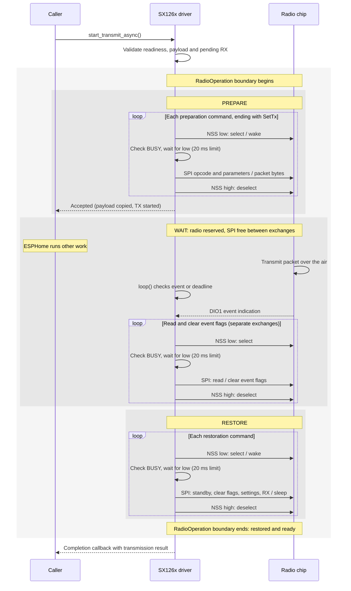

# SX126x implementation

This note describes implementation boundaries for driver maintainers. User-facing
configuration belongs in esphome.io; C++ borrowing and completion contracts belong
beside the public declarations in sx126x.h.

## The host, the radio and three different lifetimes

The host microcontroller runs ESPHome. The separate SX126x chip converts packet
bytes into radio signals and received signals back into bytes. SPI is their wired
command/data connection. The radio stores the outgoing bytes in its own buffer
before transmitting; the host does not stream bytes over SPI throughout airtime.

| Lifetime | Responsibility |
| --- | --- |
| SPI exchange | One selected interval to issue a command or transfer data. |
| Radio operation | Prepare a transmission, wait for its outcome, then restore the radio. |
| Protocol session | A higher-level conversation spanning multiple transmitted and received packets. |

Sessions, identities, delivery acknowledgments and retries belong to the protocol
using this driver. The driver handles individual packets. A TX completion reports
local transmission; it does not prove another node received the packet. Any
protocol acknowledgment arrives as a separate received packet.

| Signal | Role |
| --- | --- |
| SCK | Clock supplied by the host to move SPI bits. |
| MOSI | SPI data from the host to the radio. |
| MISO | SPI data from the radio to the host. |
| CS / NSS | Active-low chip selection for one SPI exchange. |
| BUSY | High while the chip cannot accept the next command. |
| DIO1 | Event indication, including transmission completion or packet reception. |

BUSY becoming low means the chip can accept commands, not that transmission has
finished. It can be low during airtime. DIO1 and the radio's event flags serve a
different purpose: reporting events. See the Semtech datasheet's digital interface
and operating-mode descriptions ([manufacturer documentation](https://www.semtech.com/products/wireless-rf/lora-connect/sx1262),
checked 2026-11-02).

## Life of a transmission

After configuration, the radio normally listens or sleeps according to its
applied profile. A send first validates readiness and the payload. A pending
received packet rejects admission with BUSY so `loop()` can deliver it first.
Once admitted, `RadioOperation` owns three sub-flows:

1. **Prepare:** enter standby, clear stale event flags, set packet parameters,
   copy the payload into the chip buffer and start TX. These are several separate
   SPI exchanges, ending with the command that starts transmission.
2. **Wait:** the chip sends the packet over the air. The radio remains reserved,
   but SPI is free between exchanges. `loop()` checks event flags and the software
   deadline; TX-done, timeout or cancellation ends the wait. The chip can transmit
   or receive, but not both at once.
3. **Restore:** enter standby, clear event flags, restore packet parameters and
   resume configured reception or warm sleep. Only then can the operation finish
   and the result be reported.

The diagram shows a successful asynchronous transmission. The outer shaded region
marks `RadioOperation` ownership; the inner regions mark Prepare, Wait and Restore.
Each loop iteration is a separate `Sx126xSpiDevice::exchange_()` call. Ownership is
driver state, not a thread lock or a continuously selected SPI device.



The early return means the send was accepted, not completed. The caller's payload
buffer is no longer needed, but its completion listener must remain alive.
The blocking API starts the same operation and polls until completion instead of
returning early. It therefore holds up other main-loop work during airtime.

The scopes also define failure handling. If BUSY does not clear, the exchange
releases NSS without clocking an opcode or data. A failed Prepare skips Wait and
enters Restore; a Wait timeout or cancellation also enters Restore. Restoration failure leaves
the operation in `RecoveryRequired` instead of ready, and successful configuration
is required before reuse. The restoration result takes precedence over TX success.
Releasing SPI alone cannot establish that packet settings and reception recovered.

Reception uses the same short exchanges: a DIO1 event prompts `loop()` to read
event flags, packet metadata and the received bytes, then deliver the packet to
listeners. Higher-level software interprets those bytes as a message, acknowledgment
or session event.

## One command, one selected interval

`Sx126xSpiDevice` is the persistent radio device wrapper. It privately owns
ESPHome's `spi::SPIDevice`; `read()` and `write()` delegate the selected interval
to the private `exchange_()` method. The component cannot call raw SPI transfers,
assert chip select, or bypass the BUSY check through inheritance. ESPHome's bus
configuration setters are forwarded explicitly; direct SPIDevice casts and raw
SPI calls on an SX126x instance are intentionally no longer supported.

Each `exchange_()` call constructs a noncopyable selection guard, asserts NSS,
then waits for BUSY to clear. Asserting NSS first wakes a sleeping chip. No opcode, payload,
or dummy byte is clocked if the wait fails. Scope exit releases NSS on both
success and timeout. Writes apply their switching delay after release. The
20 ms BUSY limit and SPI transfers remain synchronous; the device never holds the
shared SPI bus for packet airtime. Input/output spans are borrowed only until the
call returns. The device performs no payload allocation and invokes no callbacks.

Only the device's `exchange_()` implementation can access the SPI device. Command
encoders supply header and payload bytes, while the component translates failure
into ESPHome warnings. A completed exchange means bytes were transferred; it is
not confirmation that the chip completed a radio operation.

## Failure and configuration

Commands abort on BUSY timeout. Initial configuration failure permanently fails
setup. Runtime reconfiguration invalidates chip readiness before reset; normal
operations remain blocked until the complete configuration succeeds. Synchronous
sends clear stale IRQ flags before starting TX. These rules carry forward the
regressions from the earlier BUSY-fix proposal.

`RadioOperation` owns readiness and the complete operation lifecycle. The
component supplies preparation, waiting and restoration functions to its
`transmit()` runner. Those functions cannot set readiness, and an early return
from preparation or waiting always returns control to the runner. A restoration
function is a required argument, not a cleanup call that each error branch must
remember. Only this owner can transition to Idle after successful restoration.

Every send exit attempts standby, IRQ clearing, the configured packet parameters
and RX/sleep mode. If restoration fails, clearing BUSY alone is insufficient:
operations remain blocked until explicit configuration succeeds. Configuration
and mode changes use the same owner; reentry during preparation, waiting,
restoration or configuration is rejected. Failed mode changes require
reconfiguration, as does successful cold sleep. Warm sleep retains configuration.

The owner's private scope guard is a fallback for unexpected exits within the
owner itself: it leaves readiness invalid. It performs no SPI or recovery work
in its destructor. Fallible restoration stays explicit in the runner and its
failure takes precedence over the transmit result. The callbacks are templates,
run synchronously, and are never stored; there is no allocation or new thread.
The ESPHome adapter re-enables its loop after successful restoration/configuration,
so reception can resume without another transmission.

## Verification

The GPIO-backed fake chip exercises the real software SPI adapter and checks that
NSS is asserted before BUSY is read, no bytes follow a rejected command, and NSS
is released on all exits. Fault injection covers setup, TX, cleanup and RX.
Recovery tests compare the restored packet parameters and deliver a subsequent
received packet without another send. They also verify that failed restoration
blocks mode changes and packet handling until configuration restores readiness.
Compile-time checks ensure raw SPI methods are not publicly accessible.
Operation tests also verify early returns, reentry rejection and that a send
cannot be invoked without a restoration function. The owner cannot be copied,
so its readiness cannot be duplicated independently of the physical radio.
Host tests and embedded builds do not establish RF or physical-fault behavior.

## Radio vocabulary and applied configuration

`Sx126xCommands` encodes opcodes, register addresses, dummy bytes, packet parameters
and RX metadata. It sees only complete exchanges on `Sx126xSpiDevice`; it has no
component lifecycle, warnings, callbacks or raw SPI access. Command results are
marked `nodiscard`, and configuration distinguishes BUSY from unsupported silicon.

`SX126x` owns reset, component status and the requested/applied `RadioProfile`
values. Setters stage the requested profile. Reset invalidates readiness; the
applied snapshot changes only after every configuration command succeeds.
Sends, RX interpretation and restoration use the applied snapshot, even if a
setter has staged a different payload length or RX policy. Sync words use eight
fixed bytes per profile; snapshots require no allocation. An oversized sync word
is rejected before reset. Cold sleep invalidates configuration, while warm sleep
retains it. A successful explicit configure is required after cold sleep.

The separation allows configuration encoders to be tested without ESPHome
lifecycle policy, and lifecycle tests to assert that incomplete configuration
never permits normal operations. Existing YAML and send/mode entry points remain
available; runtime setters now explicitly stage changes until configure succeeds.

## Async continuation of the same operation lifecycle

Async support extends the `RadioOperation` owner already used by the synchronous
driver. `start_transmit()` either restores a failed preparation or retains
ownership through packet airtime. `finish_transmit()` uses the same restoration
path and rejects duplicate completion. The synchronous runner also uses these
two methods. There is no second readiness flag or component-owned state machine.

Both send APIs use the same admission, command preparation, IRQ interpretation,
deadline and restoration functions. The blocking API supplies a stack completion
listener and polls the engine while feeding the watchdog. The async API returns
after preparation; loop() polls it. No thread, queue or per-send allocation is
introduced. Each component has one `RadioOperation`, whose state is private:

```text
Unconfigured -> Configuring -> Idle
Idle -> ChangingMode -> Idle (or Unconfigured after cold sleep)
Idle -> PreparingTx -> Transmitting -> Restoring -> Idle
           failure -> Restoring -> RecoveryRequired (if restoration fails)
RecoveryRequired -> Configuring -> Idle
```

Configuration errors return to Unconfigured. Initial setup may also mark the
ESPHome component failed. Preparing and Restoring are real ownership states;
public mode/configuration requests cannot interrupt them. Failed mode changes
also enter RecoveryRequired. Idle means available for a driver-managed operation,
not the physical chip's mode: the radio may be receiving or sleeping.
One TxOperation stores only the listener and deadline, not lifecycle state.
Failed admission owes no completion. Accepted sends
complete once, after attempted restoration and ownership release. A callback can
start another send only if the state returned to Idle. RecoveryRequired rejects
sends until an explicit configure succeeds: a failed standby/cleanup cannot be
reported as recovered hardware. Cold sleep also requires configure before reuse.

TX-done means success; the radio timeout bit takes precedence if both are set.
Unrelated IRQs never imply success. The software deadline is checked at loop
cadence even when DIO1 never signals. SPI and BUSY waits remain bounded synchronous
work. Cancellation is synchronous in its caller; ordinary async completion occurs
in loop(), never in the ISR. The header documents listener and payload lifetimes.

## Receive borrowing without recursive dispatch

Only loop() reads packets and invokes receive listeners. Admission may inspect IRQ
status, but never reads a packet, acknowledges pending RX, or invokes user code.
Pending RX causes BUSY and keeps the loop enabled, letting the application retry
after delivery. This also applies to the blocking API. Stale TX IRQs do not block
admission and are cleared during preparation.

A scoped RxDelivery guard prevents recursive loop calls while listeners and
on_packet automations borrow the packet. A callback may send an echo if no other
RX is pending; this copies the payload into the chip FIFO without mutating the
borrowed buffer. Mode/configuration calls during delivery are rejected. The one
reusable RX vector reserves 255 bytes during setup, avoiding later growth in the
driver. Listeners must not retain a borrowed reference after callback return;
existing automation value-copy behavior is unchanged.

## Reading and extending the implementation

- Add byte framing only in Sx126xCommands, using the complete exchange API.
- Keep GPIO/SPI selection and BUSY timing exclusively in Sx126xSpiDevice.
- Put admission, readiness and state transitions in RadioOperation. SX126x owns
  ESPHome scheduling, warnings and callbacks; command functions report results.
- Do not add callback dispatch to admission, preparation or restoration.
- Do not hide fallible radio restoration in a destructor. Destructors release
  selection/borrowing scopes; explicit restoration reports its hardware result.
- Test new commands through the GPIO-backed fake chip, including every failure
  boundary. Test both send entry points when changing operation behavior.

Compared with the earlier review drafts, ownership is per operation rather than
an implicit combination of listener pointers and booleans. Uncertain restoration
requires reconfiguration, and pending RX is deferred rather than dispatched from
inside a send. These are intentional contracts, not hardware validation claims.
