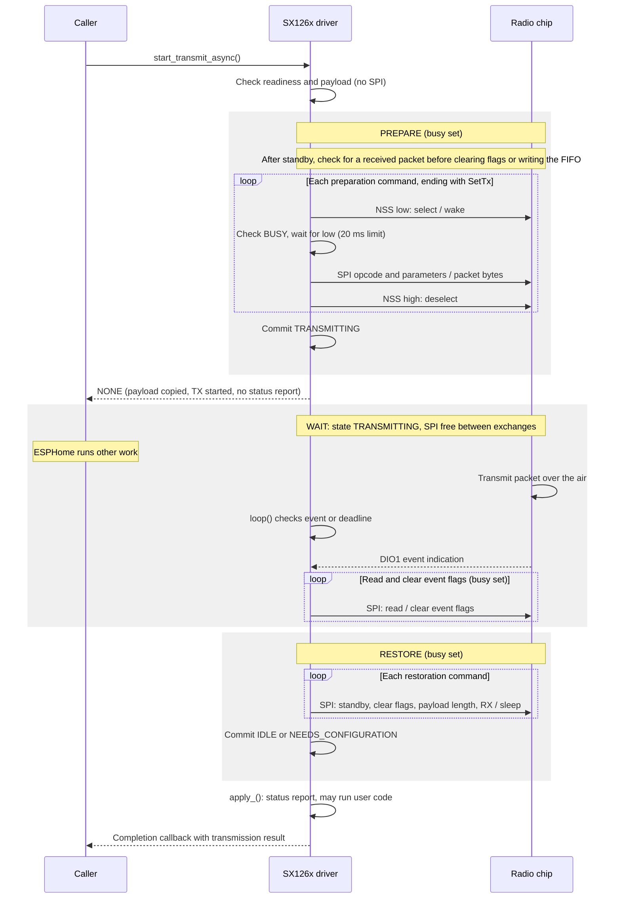
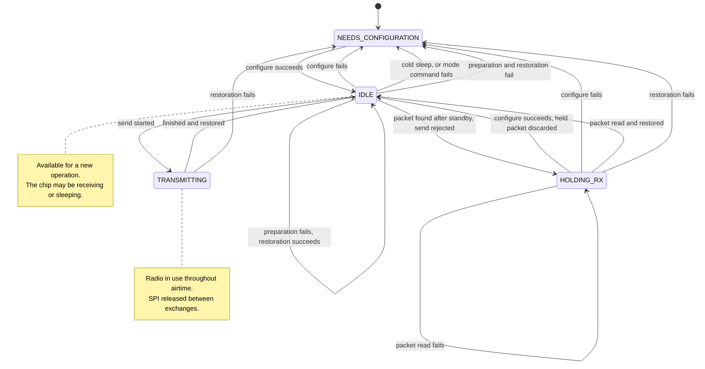

# SX126x implementation

This note describes implementation boundaries for driver maintainers. User-facing
configuration belongs in esphome.io; C++ borrowing and completion contracts belong
beside the public declarations in sx126x.h.

## The host, the radio and three different lifetimes

The host microcontroller runs ESPHome. The separate SX126x chip converts packet
bytes into radio signals and received signals back into bytes. SPI is their wired
command/data connection. The radio stores the outgoing bytes in its own buffer
before transmitting; the host does not stream bytes over SPI throughout airtime.

| Lifetime | Responsibility |
| --- | --- |
| SPI exchange | One selected interval to issue a command or transfer data. |
| Radio operation | Prepare a transmission, wait for its outcome, then restore the radio. |
| Protocol session | A higher-level conversation spanning multiple transmitted and received packets. |

Sessions, identities, delivery acknowledgments and retries belong to the protocol
using this driver. The driver handles individual packets. A TX completion reports
local transmission; it does not prove another node received the packet. Any
protocol acknowledgment arrives as a separate received packet.

| Signal | Role |
| --- | --- |
| SCK | Clock supplied by the host to move SPI bits. |
| MOSI | SPI data from the host to the radio. |
| MISO | SPI data from the radio to the host. |
| CS / NSS | Active-low chip selection for one SPI exchange. |
| BUSY | High while the chip cannot accept the next command. |
| DIO1 | Event indication, including transmission completion or packet reception. |

BUSY becoming low means the chip can accept commands, not that transmission has
finished. It can be low during airtime. DIO1 and the radio's event flags serve a
different purpose: reporting events. See the Semtech datasheet's digital interface
and operating-mode descriptions ([manufacturer documentation](https://www.semtech.com/products/wireless-rf/lora-connect/sx1262),
checked 2026-11-02).

## The ordering rule

Logging can run user code: a status change logs a message, and log listeners such
as `logger: on_message` automations run synchronously. Completion and receive
listeners are user code too. Any of them may call back into the driver.

Every operation therefore runs in the same order:

1. **SPI work**, with the radio's `busy()` flag set.
2. **Commit** the next state, which also clears `busy()`.
3. **Report status**.
4. **Call callbacks**: the transmit completion or the receive listeners.

The code is split so that this order is structural:

- `Sx126xRadio` does steps 1 and 2. It owns the state and every command sequence.
  It is not a `Component` and has no listeners, so it cannot report status or
  call user code; a compile-time check in the tests keeps it that way. Each
  operation returns a `RadioEffects` value describing steps 3 and 4.
- `SX126x::apply_()` does steps 3 and 4 from that value, and is the only place a
  radio operation runs user code. It reads nothing back from the radio afterwards.

Code that re-enters from steps 3 or 4 therefore sees a committed state: a send
that is fully started, or a radio that is fully restored or needs configuration.
It never sees a half-prepared send. This is why the driver needs no generation
counter and no transient states. In `ESPHOME_DEBUG` builds, `apply_()` asserts
that the radio is not busy whenever the effects would run user code.

Two parts remain rules rather than structure. `Sx126xRadio` must not log, because
log listeners are user code; `sx126x_radio.cpp` contains no `ESP_LOG` calls. And
`busy()` covers re-entry during step 1 itself, for example from a GPIO pin
implementation that logs: while it is set, every public operation is rejected
(sends return BUSY; mode changes and configuration log a warning and do nothing)
and `loop()` does no work.

A successful send start reports no status, so no user code runs before
`start_transmit_async()` returns. The completion reports status instead.

The reentry tests check the order through real logger callbacks: a status callback
during a failed start, a completion or a cold sleep sees committed state, and the
interrupted operation sends no further commands after the callback returns.

## Life of a transmission

After configuration, the radio normally listens or sleeps according to its
applied settings. A send first checks readiness and the payload, without any SPI
exchange. Admission then runs three sub-flows:

1. **Prepare:** enter standby, read the event flags, and stop if a packet was
   received (see below). Otherwise clear stale flags, set the payload length,
   copy the payload into the chip buffer and start TX.
2. **Wait:** the chip sends the packet over the air. The radio stays in the
   `TRANSMITTING` state, but SPI is free between exchanges. `poll_transmit()`
   checks event flags and the software deadline; TX-done, timeout or cancellation
   ends the wait. The chip can transmit or receive, but not both at once.
3. **Restore:** enter standby, clear event flags, restore the payload length and
   resume configured reception or warm sleep. Only then can the send finish and
   the result be reported.

The diagram shows a successful asynchronous transmission. Each inner loop
iteration is a separate `Sx126xSpiDevice::exchange_()` call. The radio's state is
driver state, not a thread lock or a continuously selected SPI device.

The early return means the send was accepted, not completed. The caller's payload
buffer is no longer needed, but its completion listener must remain alive.

The blocking `transmit_packet()` starts the same send with no listener, then calls
`Sx126xRadio::poll_transmit()` until its effects say `finished`, feeding the
watchdog. No user code runs between these polls, because effects are applied only
once the send has finished, and a send without a listener cannot be cancelled.
The blocking caller then applies the effects and returns that send's result; a
callback may already have started another send, and the caller does not wait for it. The blocking
API holds up other main-loop work during airtime.

If a packet was received before standby, preparation stops with BUSY and moves
to `HOLDING_RX`. The radio stays in standby with the event flags and FIFO intact,
which also stops a new reception from overwriting the packet. `loop()` reads the
packet, restores the configured mode, then delivers it; a failed read keeps the
packet for a later retry. There is no TX completion for this rejection. Explicit
reconfiguration may discard a held packet to recover from persistent read failures.

The phases also define failure handling. If BUSY does not clear, the exchange
releases NSS without clocking an opcode or data. A failed Prepare skips Wait and
enters Restore; a Wait timeout, failed event read or cancellation also enters
Restore. Restoration failure moves to `NEEDS_CONFIGURATION`, and a successful
`configure()` is required before reuse. The restoration result takes precedence
over the transmit result: a failed restoration reports BUSY_TIMEOUT. Releasing SPI
alone cannot establish that packet settings and reception recovered.

## One command, one selected interval

`Sx126xSpiDevice` is the persistent radio device wrapper. It privately owns
ESPHome's `spi::SPIDevice`; `read()` and `write()` delegate the selected interval
to the private `exchange_()` method. The component cannot call raw SPI transfers,
assert chip select, or bypass the BUSY check through inheritance. ESPHome's bus
configuration setters are forwarded explicitly; direct SPIDevice casts and raw
SPI calls on an SX126x instance are intentionally no longer supported.

Each `exchange_()` call constructs a noncopyable selection guard, asserts NSS,
then waits for BUSY to clear. Asserting NSS first wakes a sleeping chip. No opcode,
payload or dummy byte is clocked if the wait fails. Scope exit releases NSS on
both success and timeout. Writes apply their switching delay after release. The
20 ms BUSY limit and SPI transfers remain synchronous; the device never holds the
shared SPI bus for packet airtime. Input/output spans are borrowed only until the
call returns. The device performs no payload allocation and invokes no callbacks.

Failures stick. `begin()` starts a command sequence; the first BUSY timeout sets
a failure flag, and every later exchange in the sequence is skipped without
selecting the chip. The caller checks `ok()` once at the end of the sequence, or
before acting on a value it read. A skipped or failed read leaves its buffer
unchanged, and `read_irq()` returns 0, so a failed read never looks like an event.
Restoration after a failed preparation starts a new sequence.

A completed exchange means bytes were transferred; it is not confirmation that
the chip completed a radio operation.

## Radio vocabulary and applied settings

`Sx126xCommands` encodes opcodes, register addresses, dummy bytes, packet
parameters and RX metadata, and owns the `Sx126xSpiDevice`. It has no component
lifecycle, warnings, callbacks or raw SPI access. Commands return nothing; their
failure is recorded in the SPI device. Configuration distinguishes BUSY timeouts
from unsupported silicon.

`Sx126xRadio` owns reset, the state and the `AppliedProfile`; `SX126x` owns
component status and the requested `RadioProfile`. Setters change the requested
profile only. The applied settings
change only after every configuration command succeeds. They hold just what
runtime operations read: the frequency for calibration, the payload length, the
modulation for RX metadata, the RX start policy for restoration, and the
SetPacketParams bytes, encoded once during configuration. Sends and restoration
only change the payload length byte. Sends, RX interpretation and restoration use
the applied settings, even if a setter has requested a different payload length
or RX policy.

Sync words use eight fixed bytes, so profiles need no allocation. An oversized
sync word is rejected by YAML validation and again in C++ before reset. Cold sleep
invalidates configuration, while warm sleep retains it.

## States

Each `Sx126xRadio` has one private state, plus the busy flag during SPI work:

| Request | NEEDS_CONFIGURATION | IDLE | TRANSMITTING | HOLDING_RX | busy |
| --- | --- | --- | --- | --- | --- |
| Send | NOT_READY | runs | BUSY | BUSY | BUSY |
| Mode change, calibration | ignored | runs | ignored | ignored | ignored |
| `configure()` | runs | runs | ignored | runs | ignored |
| `cancel_transmit_async()` | false | false | runs for its listener | false | false |

`IDLE` means available for a driver-managed operation, not the physical chip's
mode. Startup, cold sleep, failed configuration, failed mode changes and failed
restoration all use `NEEDS_CONFIGURATION`. The error result and logs report why;
the state only decides which operations are allowed. An initial setup failure
also marks the ESPHome component permanently failed.

`apply_()` enables the ESPHome loop for every state except
`NEEDS_CONFIGURATION`, where the effects ask for the loop to sleep because polling
cannot recover the radio. Successful `configure()` enables it again, even without a DIO1
edge. In `IDLE`, the loop may sleep when an internal DIO1 pin is low; the interrupt
wakes it. External pins continue to be polled.

Failed receive exchanges use a 200 ms retry gate on the cached loop clock,
including across clock rollover. The loop stays enabled while an IRQ or held
packet needs retrying; the gate avoids repeating the 20 ms BUSY wait on every
loop. Successful configuration clears the gate. TX polling runs before the gate,
so it is never delayed by it.

## Completion and status

Failed admission owes no completion. An accepted send completes exactly once.
`Sx126xRadio::finish_transmit_()` is the only place a send ends: it restores the
radio, commits the state and moves the stored listener into the effects. `apply_()`
then reports status, and only then calls the listener. A callback can start another send only if the state returned to
`IDLE`. Cancellation is synchronous in its caller; ordinary completion runs in
`loop()`, never in the ISR.

TX-done means success; the radio timeout bit takes precedence if both are set.
Unrelated IRQs never imply success. The software deadline is checked at loop
cadence even when DIO1 never signals.

Status reflects whether the radio ended the operation usable. A failed exchange
followed by a successful restoration clears the warning; a failed restoration,
configuration, mode change or receive read sets it. Blocking sends also log
`Packet send failed: <reason>` for every failure, with the reason taken from a
PROGMEM string table. Async callers handle the returned result themselves; the
driver does not log routine async rejections.

`dump_config()` always prints the requested profile, including after failed
setup or failed runtime configuration, and separately reports whether the radio is
ready. Requested settings can differ from the applied settings until `configure()`
succeeds.

## Receive borrowing without recursive dispatch

Only `loop()` reads packets, through `Sx126xRadio::poll()`, and `apply_()` calls
receive listeners. Sending may read the event
flags, but never reads a packet, clears a received packet's flags, or calls
receive listeners.

`rx_dispatching_` is set from the receive status report until the listeners
return. While it is set, `loop()` returns at once, so even an explicit `loop()`
call from a listener cannot overwrite the borrowed packet. A listener may send a
reply: this copies the payload into the chip FIFO without changing the borrowed
buffer. If another packet was already received, that send returns BUSY and the new
packet is held for the next `loop()`. Mode and configuration calls during delivery
are allowed when the state permits them; they never change the borrowed packet.
The one reusable RX vector reserves 255 bytes during setup, avoiding later growth.
Listeners must not keep a reference to the packet after they return.

## Verification

The GPIO-backed fake chip exercises the real software SPI adapter and checks that
NSS is asserted before BUSY is read, no bytes follow a rejected command, and NSS
is released on all exits. Fault injection covers every command of setup, sends,
cleanup and receive. Recovery tests compare the restored packet parameters and
deliver a later received packet without another send. They also verify that
failed restoration blocks mode changes and packet handling until configuration
succeeds. Reentry tests check the ordering rule through real logger callbacks.
Compile-time checks ensure raw SPI methods are not publicly accessible. Host tests
and embedded builds do not establish RF or physical-fault behavior.

## Reading and extending the implementation

- Add byte framing only in `Sx126xCommands`, using the complete exchange API.
- Keep GPIO/SPI selection and BUSY timing exclusively in `Sx126xSpiDevice`.
- Put command sequences and state changes in `Sx126xRadio`, and return what the
  component must do as `RadioEffects`. Do not log there.
- Run user code only from `SX126x::apply_()`. Once it has run user code, `apply_()`
  must not read radio state again; callbacks themselves may call any public method.
- Start each command sequence with `begin()` and check `ok()` before acting on a
  value read in it.
- End every send through `Sx126xRadio::finish_transmit_()`.
- Test new commands through the GPIO-backed fake chip, including every failure
  boundary. Test both send entry points when changing send behavior.
